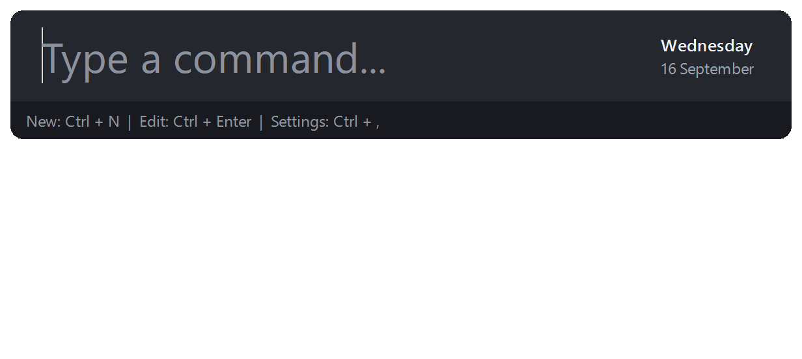
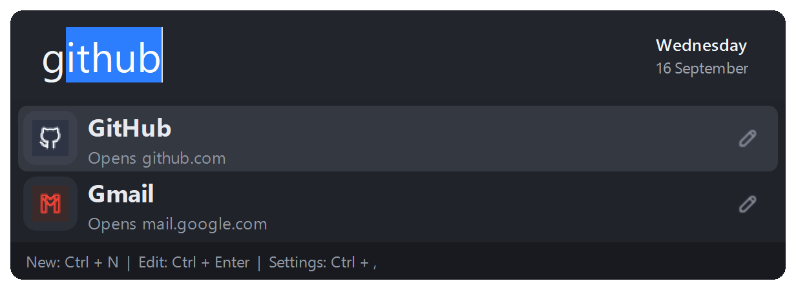

<h1 align="center">
   
</h1>

<p align="center">
   <strong>A keyboard launcher for Windows where the same letters always open the same thing.</strong>
</p>

<p align="center">
   <a href="https://github.com/CalemYoung/Dash/releases"></a>
   
   <a href="LICENSE"></a>
</p>

---

Press `Alt+Space`, type a few letters, and Dash opens the app, file, folder or
website you gave those letters to. Nothing is indexed, so results are instant
and never shuffle around.

```powershell
winget install -e dash
```

Or download the installer from [Releases](https://github.com/CalemYoung/Dash/releases).

## Why another launcher?

Dash came out of using launchers that index everything on the machine. They
lagged while typing, and being non-deterministic can mean searching for the
correct result in a list. With Dash you only get what you expect.

If you want a launcher that searches all your files, there are good options
(Flow Launcher, Everything, PowerToys). Dash is for a simple launcher that only
contains the commands you set.

## What it does

- Opens apps, files, folders, websites, Store apps and Windows Settings pages.
- Aliases: `gh` opens GitHub. If nothing else starts with those letters, the
  alias opens as soon as you type it, no Enter needed.
- Site search: give a website `{query}` in its address and `gh dash` searches it.
- Groups: one command that opens several, in order.
- Quick sums: `12*8` or `200+15%`, Enter copies the answer.
- If an app is already open, Dash switches to it instead of starting another.
- Type something you haven't added and press `↓` to see matching apps,
  folders and sites on your PC, ready to add as a command.
- Works entirely from the keyboard, Settings included.

<p align="left">
   
</p>

<p align="left">
   
</p>

## Keys

| Key | Does |
| --- | --- |
| `Alt+Space` | Open Dash |
| `Enter` | Open the selected command |
| `Tab` | Complete the selected name or alias |
| `Ctrl+Enter` | Edit the selected command |
| `Ctrl+N` | Add a new command from what you typed |
| `Ctrl+,` | Settings |
| Right-click | More: run as admin, open folder, copy path |
| `Esc` | Close |

The keyboard icon in the launcher's corner lists the rest. The hotkey and
shortcuts can be changed in Settings.

## Getting started

The first time you open Dash, choose "Find recommended commands". It offers
your installed programs, Windows tools and Settings pages, Quick Access
folders, browser bookmarks and popular websites. Pick what you want; nothing
is added until you do. Press `Ctrl+Enter` on any result to edit it.

Settings and commands live in `%APPDATA%\Dash`, so updates keep them. Dash
checks GitHub for updates when it starts and asks before installing anything.

## Privacy

No telemetry. Dash only goes online to check for updates, fetch website icons
and open the sites you ask for, and the first two can be turned off.
[PRIVACY.md](PRIVACY.md) lists every request.

## Problems

The log is at `%APPDATA%\Dash\logs\dash.log` ("Open Log Folder" in the tray
menu). Attach it when you [report a bug](https://github.com/CalemYoung/Dash/issues/new/choose).
Release notes are in [CHANGELOG.md](CHANGELOG.md).

## Development

Needs Windows and Python 3.11+.

```powershell
py -3.11 -m venv .venv
.\.venv\Scripts\Activate.ps1
python -m pip install -r requirements-dev.txt
python dash.py
```

Run the tests with `python -m pytest`. See [CONTRIBUTING.md](CONTRIBUTING.md).

<details>
<summary><strong>Building and releasing</strong></summary>

<br>

Build the installer locally (needs [Inno Setup 6](https://jrsoftware.org/isinfo.php)):

```powershell
.\.venv\Scripts\python.exe build\scripts\build_installer.py
```

It writes `dist/DashSetup-<version>.exe`, using the version in
`build/installer/version.txt`.

To release, set that version, commit, then push a matching tag. GitHub
Actions builds the installer and attaches it to the release.

```powershell
git tag v2.11.0
git push origin v2.11.0
```

</details>

## License

[MIT](LICENSE)
